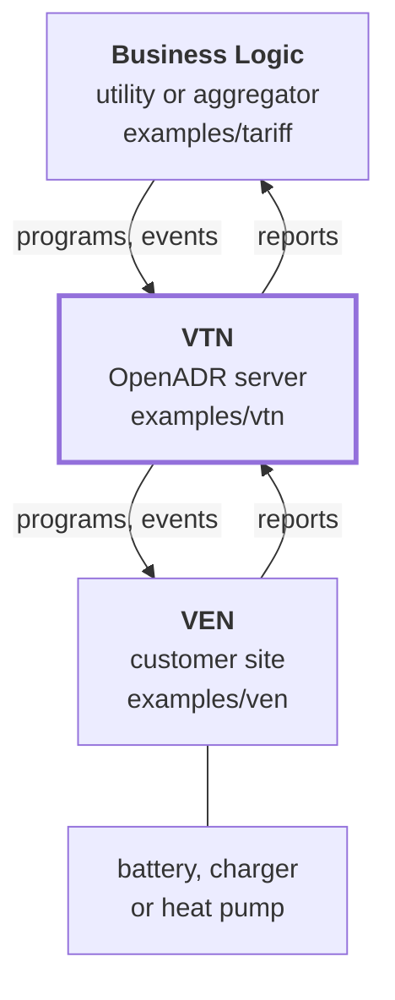
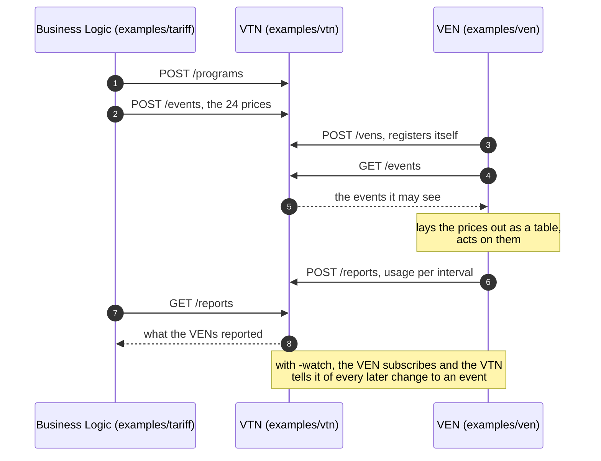

# go-openadr — OpenADR 3 for Go

[](https://go.dev/)
[](https://pkg.go.dev/github.com/otfabric/go-openadr)
[](LICENSE)
[](https://github.com/otfabric/go-openadr/actions/workflows/ci.yml)
[](https://github.com/otfabric/go-openadr/actions/workflows/interop.yml)
[](https://codecov.io/gh/otfabric/go-openadr)
[](https://github.com/otfabric/go-openadr/releases)

A Go implementation of [OpenADR 3](https://www.openadr.org/specification),
the demand-response protocol between utilities or aggregators and the
energy resources of their customers. It follows the specification of the
[OpenADR Alliance](https://www.openadr.org/specification), revision 3.1.0,
whose documents are public: the OpenAPI definition, the Definition and the
User Guide, in
[grid-coordination/openadr3-specification](https://github.com/grid-coordination/openadr3-specification).
It provides both sides of the REST API:

- **`client`**: a VEN client and a Business Logic client for any OpenADR 3.1 VTN;
- **`server`**: a VTN as an embeddable `http.Handler`;
- **`openadr`** (the module root): the domain model both share;
- **`notification/webhook`**, **`notification/mqtt`** and
  **`notification/websocket`**: the ways a VTN tells its clients, each for
  both sides;
- **`timeline`**: the intervals of an event or a report as a table, with
  the timing rules of the specification applied, and as CSV;
- **`discovery`**: finding a VTN on the local network, and being found.

## The three roles

An OpenADR 3 system has three kinds of participant, and this module has a
part for each:

| Role | What it does | Here |
|---|---|---|
| **VTN** (virtual top node) | The server in the middle. It stores programs, events and reports, authenticates the other two, decides who may see what, and notifies of changes. It does not make prices or decisions. | `server`, an `http.Handler` to embed; [examples/vtn](examples/vtn/main.go) runs one |
| **Business Logic** (BL) | The utility's or aggregator's side: whatever application creates programs and publishes events, a tariff say, and reads the reports that come back. A client of the VTN, not a protocol of its own. | `client.BL`; [examples/tariff](examples/tariff/main.go) publishes a price schedule from a CSV file |
| **VEN** (virtual end node) | The customer's side: an energy management system, a charger, a gateway. It reads the events meant for it, hands them to whatever controls the equipment, and reports back, on metered usage for example. Also a client of the VTN. | `client.VEN`; [examples/ven](examples/ven/main.go) prints its schedule and reports |



The arrows show which way the data goes, not who calls whom: every request
is made by one of the two clients, to the VTN. The clients never talk to
each other, and the VTN reaches a client by itself only to notify it of a
change. [Examples](#examples) runs this loop as three programs, step by
step.

**Status: pre-release.** OpenADR 3.1.0 only. All 45 operations of the
specification are implemented in the VTN, with OAuth2 client credentials or
JSON Web Tokens, scopes, object ownership, targeting, and notifications by
webhook and by MQTT; a VTN can also serve clients that do not authenticate,
compress its answers, and announce itself on the local network. Two things
go beyond the specification, both shared with OpenLEADR and both off unless
asked for: notifications over a WebSocket, and resource groups. The API may
still change.

The clients are tested against the OpenLEADR VTN — MQTT and WebSocket
notifications and resource groups included — and the VTN with the ElaadNL
client; webhooks, and the VTN's side of MQTT and of WebSockets, are so far
tested between this module's own two sides only. See
[INTEROP.md](INTEROP.md) for the evidence,
[docs/CONFORMANCE.md](docs/CONFORMANCE.md) for exactly what is covered and
[PLAN.md](PLAN.md) for what comes next.

Out of scope: OpenADR 2.x, dispatch or optimization logic, integrations with
physical resources (Modbus, OPC UA, ...), a web UI and a CLI. The library
implements the protocol; what to do with a price or a load-shed request is
the application's business.

## go-openadr vs OpenLEADR and the ElaadNL client

go-openadr is tested against two other open-source implementations of
OpenADR 3 (see [INTEROP.md](INTEROP.md)): the
[OpenLEADR](https://github.com/OpenLEADR/openleadr-rs) VTN and client
library, and the [ElaadNL openadr3-client](https://github.com/ElaadNL/openadr3-client).
Both are good software, and each does things this module does not. The
table shows where the three differ, so that you can pick the right one:
where this module still has to catch up, and, in its lower half, what it
has that the others do not show.

| Capability | otfabric/go-openadr | OpenLEADR openleadr-rs | ElaadNL openadr3-client |
|---|:---:|:---:|:---:|
| Language | Go | Rust | Python |
| License | MIT | Apache-2.0 or MIT | Apache-2.0 |
| VTN (server) | ✅ embeddable `http.Handler` | ✅ standalone service | — |
| VEN client | ✅ | ✅ | ✅ |
| Business Logic client | ✅ | ✅ same client | ✅ |
| OpenADR 3.1.0 | ✅ | ✅ | ✅ |
| OpenADR 3.0.1 | — planned | — | ✅ |
| Programs, events, reports, VENs, resources | ✅ | ✅ | ✅ |
| Subscriptions | ✅ | ✅ delivered over WebSocket | ✅ |
| Webhook notifications | ✅ sender and receiver | — | — not documented |
| MQTT notifications | ✅ publisher and subscriber ¹ | ✅ | ✅ client, optional extra |
| MQTT topic operations (12) | ✅ | ✅ 11, none for subscriptions | ✅ |
| WebSocket notifications (not in the specification) | ✅ VTN and client ³ | ✅ VTN, experimental | — |
| OAuth2 client credentials, token caching and renewal | ✅ | ✅ | ✅ |
| Token endpoint discovery (`/auth/server`) | ✅ | ✅ | ✅ |
| Built-in token service for the VTN | ✅ in memory, for tests and small setups | ✅ users in the database | n/a |
| JSON Web Tokens from an external identity provider | ✅ static keys and JWKS | ✅ | n/a |
| VTN without authentication | ✅ VTN option, and a client without credentials | — not documented | ✅ anonymous client |
| Targeting with target hiding | ✅ | ✅ | n/a |
| Persistent storage | ✅ journal file ²; SQLite and PostgreSQL stores as examples ⁷ | ✅ PostgreSQL | n/a |
| Storage behind an interface (bring your own) | ✅ with a test suite for your store | prepared, PostgreSQL only | n/a |
| Resource groups (proposed for OpenADR 3.2) | ✅ opt-in, as OpenLEADR has them ³ | ✅ | ✅ |
| mDNS discovery of local VTNs | ✅ announce and browse ⁴ | ✅ | — |
| Response compression | ✅ gzip, deflate ⁶ | ✅ gzip, br, deflate, zstd | — |
| Typed, validated models | ✅ | ✅ | ✅ pydantic |
| Extra validation by plugin | — | — | ✅ |
| Event intervals as tables | ✅ `timeline`, with CSV ⁵ | — | ✅ pandas, optional |
| Cancellation and deadlines per call | ✅ `context.Context` | ✅ async | — timeouts |
| Structured logging | ✅ `log/slog`, opt-in, client and VTN | ✅ | ✅ |
| Metrics hooks | ✅ client, VTN and notifications; no metrics library needed | — not documented | — |
| Client retries with backoff | ✅ opt-in policy, `Retry-After` honoured | — not documented | — not documented |
| Error categories to test for | ✅ sentinels for `errors.Is` | ✅ error enum | ✅ exceptions |
| Dependencies | none (standard library) | many crates; PostgreSQL to run | several packages |
| Run against the OpenADR Alliance test suite | — | ✅ 166 of 168 applicable, by its authors | — not documented |
| Cross-tested against other implementations in CI | ✅ against both | — not documented | — not documented |
| MQTT tested on several brokers | ✅ Mosquitto, NanoMQ, HiveMQ CE, EMQX | — not documented | — not documented |
| mDNS tested against other implementations | ✅ Avahi, Apple mDNSResponder, OpenLEADR | — not documented | n/a |
| Failure-injection tests (store, network, webhooks, broker, tokens, crash) | ✅ `make chaos` | — not documented | — not documented |
| Fuzzed parsers | ✅ six targets | — not documented | — not documented |
| Authorization matrix: every operation as every kind of client | ✅ 54 rows, five clients | — not documented | n/a |
| The three roles as runnable programs (VTN, Business Logic, VEN) | ✅ examples, run together in the tests | ✅ VTN and a client CLI | — |

¹ The MQTT client is this module's own (MQTT 3.1.1, QoS 1). The VTN's
publisher and the subscriber are tested on four brokers: Eclipse Mosquitto,
NanoMQ, HiveMQ Community Edition and EMQX. The subscriber is also tested
with the notifications OpenLEADR publishes.

² One process, all objects in memory, every change appended to a file. Not
a database: for a large VTN, put `storage.Store` on one.

³ Neither is part of OpenADR 3.1.0. Both follow OpenLEADR's representation,
and this module's clients are tested against OpenLEADR for both. Resource
groups will change with the specification that adopts them.

⁴ This module's own Multicast DNS, over IPv4. Tested in both directions
with Avahi, with Apple's mDNSResponder and with OpenLEADR: each finds what
this module announces, and this module finds what each announces.

⁵ Rows of Go values and CSV, not a data-frame library. It also applies the
timing rules of the specification (defaults, "now", sub-intervals, events
that repeat), which the table of the ElaadNL client leaves to its user.

✅ = available · — = not available or not documented · n/a = does not apply
to a client library. For openleadr-rs v0.2.7 and openadr3-client 2.4.0, the
versions go-openadr is tested against, from their public sources and
documentation as of October 2026. If you spot an inaccuracy, please
[open an issue](https://github.com/otfabric/go-openadr/issues) and we will
correct it.

⁶ The two codings Go's standard library can write. br and zstd would each
need a dependency, which this module does not take.

⁷ [examples/storage](examples/storage/README.md) implements the store on
SQLite and on PostgreSQL. It is a module of its own, so that the database
drivers are not dependencies of go-openadr, and it is an example: read it,
copy it, hold your own to the same test suite (`storagetest.Run`).

**Choose go-openadr if** you want both sides of the protocol in one Go
module without dependencies, a VTN you embed in your own service with your
own identity provider and store, webhook notifications, or the hooks a
service in production wants: metrics, logs, retries with backoff and errors
to switch on.

**Choose OpenLEADR if** you want a VTN to deploy as it is, backed by
PostgreSQL, that its authors have run against the Alliance's test suite.

**Choose the ElaadNL client if** you write a VEN or Business Logic in
Python, or need OpenADR 3.0.1.

## Install

```sh
go get github.com/otfabric/go-openadr
```

Go 1.23 or later. No dependencies outside the standard library.

## A VEN

```go
ven, err := client.NewVEN(client.Config{
    BaseURL:     "https://vtn.example.com/openadr3",
    Credentials: &client.Credentials{ClientID: id, ClientSecret: secret},
})
if err != nil {
    return err
}

events, err := ven.Events(ctx, client.EventQuery{ProgramID: programID, ActiveOnly: true})
if err != nil {
    return err
}
for _, event := range events {
    for _, interval := range event.Intervals {
        for _, payload := range interval.Payloads {
            if price, ok := payload.Values[0].Number(); ok && payload.Type == "PRICE" {
                fmt.Println(interval.ID, price)
            }
        }
    }
}

_, err = ven.CreateReport(ctx, openadr.Report{
    EventID:    events[0].ID,
    ClientName: "site-42",
    Resources: []openadr.ReportResource{{
        ResourceName: "main-meter",
        Intervals: []openadr.Interval{{ID: 0, Payloads: []openadr.ValuesMap{
            {Type: "USAGE", Values: []openadr.Value{openadr.Number(1.8)}},
        }}},
    }},
})
```

The client discovers the token endpoint from the VTN (`GET /auth/server`),
obtains a token, keeps it until shortly before it expires, and fetches a new
one when the VTN answers 401. `client.BL` is the same for the Business Logic
side: it creates programs and events, provisions VENs and their targets, and
reads reports.

Errors from the VTN are `*openadr.Error` values and match sentinels:

```go
if errors.Is(err, openadr.ErrNotFound) { ... }
```

## A VTN

```go
vtn, err := server.New(server.Config{
    Store:     storage.NewMemory(),
    Validator: validator,              // resolves a bearer token to a client ID and scopes
    TokenURL:  "https://idp.example.com/oauth/token",
})
if err != nil {
    return err
}
http.Handle("/openadr3/", http.StripPrefix("/openadr3", vtn))
```

The server does not bundle an identity provider: it takes an
`auth.Validator`. For tests and small deployments, `auth.Issuer` is an
in-memory client-credentials token service that is both the `/auth/token`
handler and the validator, and `auth.JWTValidator` validates the JSON Web
Tokens of an identity provider, with static keys or its key set (JWKS).
`storage.OpenFile` is a store that survives a restart. `TokenURL` is what `GET /auth/server` tells clients
and has to be an absolute URL.

[examples/quickstart](examples/quickstart/main.go) runs a VTN, a Business
Logic client and a VEN through the program → event → report workflow in one
process:

```sh
go run ./examples/quickstart
```

[examples/vtn](examples/vtn/main.go) is a standalone VTN to point other
clients at.

### Public information

A VTN whose programs are for everyone, a price list say, can let clients in
without a token, as the specification provides:

```go
vtn, err := server.New(server.Config{ /* ... */ AllowAnonymous: true})
```

Such a client reads the programs and events that have no targets, and
nothing else; a request that carries a token is checked as always. A client
is anonymous by having no credentials: `client.NewVEN(client.Config{BaseURL: url})`.
[examples/prices](examples/prices/main.go) runs both.

### Finding a VTN on the local network

A VTN at a customer site, a gateway, announces itself with DNS-SD over
Multicast DNS, and a VEN on the same network finds it without being
configured:

```go
ad, err := discovery.Advertise(discovery.Advertisement{Port: 8443, BasePath: "openadr3"})
defer ad.Close()
```

```go
vtns, err := discovery.Browse(ctx, discovery.Options{First: true})
if err == nil && len(vtns) > 0 {
    ven, err = client.NewVEN(client.Config{BaseURL: vtns[0].URL(), Credentials: credentials})
}
```

What is found is an address to try, not a VTN to trust: see
[SECURITY.md](SECURITY.md).

## Intervals as a table

An event writes its intervals compactly: a default start and duration, an
interval that overrides one of them or follows the one before, a start that
means "now", several values packed into one interval, a duration of the
event that cuts the intervals short or repeats them. `timeline` applies
those rules and returns rows with a start and an end:

```go
rows, err := timeline.OfEvent(event, timeline.Options{SubIntervals: true})
if err != nil {
    return err
}
for _, row := range rows.At(time.Now()) {      // what applies now
    fmt.Println(row.Type, row.Values, "until", row.End)
}
err = rows.WriteCSV(os.Stdout)
```

The other way, a table read from CSV becomes the intervals of an event:

```go
table, err := timeline.ReadCSV(file)   // columns: start, end, type, values
event := openadr.Event{ProgramID: programID, Intervals: table.Intervals()}
```

## Notifications

A client that would rather be told than poll subscribes with a webhook:

```go
http.Handle("/openadr", &webhook.Handler{
    BearerToken: hookToken, // made up for this subscription
    Notify: func(ctx context.Context, n openadr.Notification) error {
        if event, ok := n.Object.(openadr.Event); ok {
            // n.Operation is CREATE, UPDATE or DELETE
        }
        return nil
    },
})

_, err = ven.CreateSubscription(ctx, openadr.Subscription{
    ClientName: "site-42",
    ObjectOperations: []openadr.ObjectOperation{{
        Objects:     []openadr.ObjectType{openadr.ObjectEvent},
        Operations:  []openadr.Operation{openadr.OperationCreate, openadr.OperationUpdate},
        CallbackURL: "https://site-42.example.com/openadr",
        BearerToken: hookToken,
    }},
})
```

The VTN verifies the callback URL before it accepts the subscription, so the
handler has to be reachable first. A VTN serves subscriptions when it is
given a sender:

```go
sender := webhook.NewSender(webhook.SenderConfig{})
defer sender.Close(ctx)
vtn, err := server.New(server.Config{ /* ... */ Webhooks: sender})
```

Delivery is at least once and not durable: a client that must not miss a
change still polls now and then.
[examples/notifications](examples/notifications/main.go) runs both sides.

A VTN with an MQTT broker publishes the same notifications there
(`server.Config.MQTT` with a `mqtt.Publisher`), and a client asks the VTN
for the broker and for its topics and subscribes:

```go
notifiers, err := ven.Notifiers(ctx)                              // where the broker is
topics, err := ven.MQTTTopics(ctx, client.EventsForVEN(venID))    // what this VEN may hear
sub, err := mqtt.NewSubscriber(mqtt.SubscriberConfig{
    Broker: mqtt.Broker{URL: notifiers.MQTT.URIs[0]},
    Topics: []string{topics.All},
    Notify: func(ctx context.Context, topic string, n openadr.Notification) { /* ... */ },
})
```

The broker is yours to run, and its access control decides who can read
which topic: see [SECURITY.md](SECURITY.md).

A third way needs neither an address the VTN can reach nor a broker: the
client opens a WebSocket and is told there. This is not part of OpenADR
3.1.0; it is an extension of OpenLEADR, which this module's VTN offers when
it is given `server.Config.WebSocket`, and `GET /notifiers` says whether a
VTN has it.

```go
_, err = ven.CreateSubscription(ctx, openadr.Subscription{
    ClientName: "site-42",
    ObjectOperations: []openadr.ObjectOperation{{
        Objects:    []openadr.ObjectType{openadr.ObjectEvent},
        Operations: []openadr.Operation{openadr.OperationCreate, openadr.OperationUpdate},
        Mechanism:  openadr.MechanismWebSocket,      // in place of a callback URL
    }},
})
sub, err := websocket.NewSubscriber(websocket.SubscriberConfig{
    Dial:   ven.NotificationStream,
    Notify: func(ctx context.Context, n openadr.Notification) { /* ... */ },
})
```

The subscriber reconnects by itself. Whichever way it is notified, a client
that must not miss a change searches after every reconnect: none of the
three keeps notifications for a client that is away.
[examples/websocket](examples/websocket/main.go) runs both sides.

## Examples

| Example | What it shows |
|---|---|
| [quickstart](examples/quickstart/main.go) | The basic workflow in one process: program, event, report. |
| [notifications](examples/notifications/main.go) | Subscriptions and webhooks, both sides. |
| [websocket](examples/websocket/main.go) | Notifications over a WebSocket, both sides. |
| [prices](examples/prices/main.go) | A VTN with a public tariff, a client without credentials, the prices as a table. |
| [resourcegroups](examples/resourcegroups/main.go) | Resource groups, as Business Logic and as a VEN see them. |
| [discovery](examples/discovery/main.go) | Announcing a VTN on the local network, and finding it. |
| [vtn](examples/vtn/main.go) | A standalone VTN with flags for every option, to point clients at. |
| [ven](examples/ven/main.go) | A VEN for the command line: finds a VTN, registers, prints its schedule, reports, watches. |
| [tariff](examples/tariff/main.go) | Business Logic for the command line: publishes a schedule from a CSV file, and reads the reports on it. |
| [observability](examples/observability/main.go) | Metrics and logs of a client and a VTN, a retry policy at work against a gateway that fails, and failures told apart by `errors.Is`. |
| [storage](examples/storage/README.md) | The VTN on SQLite and on PostgreSQL: the store interface implemented on a database. A module of its own. |

The first six and `observability` are self-contained and run as they are
(`go run ./examples/quickstart`); CI runs them. `vtn`, `ven` and `tariff`
work together:

```sh
# the VTN, with a client for each of the other two
go run ./examples/vtn -client utility:utility-secret:bl -client site-42:site-42-secret:ven -websocket &

# Business Logic publishes a tariff
BL_CLIENT_SECRET=utility-secret go run ./examples/tariff -url http://127.0.0.1:8080 -client-id utility -program day-ahead -csv prices.csv

# the VEN reads it and reports its usage (with -watch it stays and is told of changes)
VEN_CLIENT_SECRET=site-42-secret go run ./examples/ven -url http://127.0.0.1:8080 -client-id site-42 -report

# Business Logic reads the report
BL_CLIENT_SECRET=utility-secret go run ./examples/tariff -url http://127.0.0.1:8080 -client-id utility -program day-ahead -reports
```

What goes over the wire while they run:



Each first asks the VTN for a token (`GET /auth/server`, then the token
endpoint), which the diagram leaves out. `TestThreeRolesAsPrograms` in
`e2e/` runs exactly these four commands on every run of the tests, with a
restart of the VTN in the middle.

`prices.csv` has a header line and one line per period:

```
start,end,type,values
2026-10-14T00:00:00Z,2026-10-14T01:00:00Z,PRICE,0.11
2026-10-14T01:00:00Z,2026-10-14T02:00:00Z,PRICE,0.12
```

## Things to know

- **Concurrency.** Clients and the server are safe for concurrent use.
- **Timeouts.** Every client call takes a context that bounds the whole
  call, including a token request it may trigger. The default HTTP client
  has a 30 second timeout; pass your own `http.Client` for TLS settings,
  proxies or other limits.
- **Paging.** A VTN returns at most 50 objects per search. `client.Each`
  iterates over a whole result.
- **Values.** JSON does not distinguish integers from other numbers, so
  payload numbers are `float64`.
- **Validation.** Objects are checked against the schema before they are
  sent; a violation is an `*openadr.ValidationError` and no request is made.
  Payload types, units and other enumerations of the specification are plain
  strings and are not restricted, so private values work.
- **Compression.** The VTN compresses answers of 1 KiB and more with gzip
  or deflate for a client that accepts one, which the clients of this
  module do (gzip).
- **Extensions.** Resource groups and WebSocket notifications are not part
  of OpenADR 3.1.0. A VTN has neither unless its configuration says so, and
  the clients' methods for them are answered with 404 or 501 by a VTN that
  has not.
- **Shutdown.** A VTN with WebSockets has connections of its own: call
  `Server.Close` when it stops, before the HTTP server's `Shutdown`.
- **Errors.** Every failure matches a sentinel of package `openadr` with
  `errors.Is`: `ErrNotFound`, `ErrConflict`, `ErrUnavailable`,
  `ErrTimeout`, `ErrInvalid` and the rest of [ERRORS.md](ERRORS.md).
- **Retries.** None by default, beyond one retry with a fresh token after a
  401. `client.Config.RetryPolicy` adds them with backoff, for what is
  safe to repeat: see [OBSERVABILITY.md](OBSERVABILITY.md).
- **Logging and metrics.** The library is silent and counts nothing unless
  told to: each part takes a `slog.Logger` and a small metrics interface in
  its configuration. See [OBSERVABILITY.md](OBSERVABILITY.md).
- **Storage.** The VTN keeps its objects behind `storage.Store`: in memory,
  in a journal file, or on a database of yours
  ([examples/storage](examples/storage/README.md) has SQLite and PostgreSQL).

## Specification

- [OpenADR Alliance: specification](https://www.openadr.org/specification):
  the official home of OpenADR 3.
- [grid-coordination/openadr3-specification](https://github.com/grid-coordination/openadr3-specification):
  the documents themselves, per revision. This module implements
  [3.1.0](https://github.com/grid-coordination/openadr3-specification/tree/main/3.1.0):
  the OpenAPI document (`openadr3.yaml`), the Definition and the User Guide.
- [docs/CONFORMANCE.md](docs/CONFORMANCE.md): which of it this module
  covers, and how it reads the parts that leave room.

## Documentation

- [API.md](API.md): the public API by package, and the behaviour that
  signatures do not show.
- [ERRORS.md](ERRORS.md): every error a caller can get, and how to tell them
  apart.
- [OBSERVABILITY.md](OBSERVABILITY.md): logging, metrics and retries.
- [INTEROP.md](INTEROP.md): what has been tested against which other
  implementation, and how to repeat it.
- [docs/CONFORMANCE.md](docs/CONFORMANCE.md): operation coverage, and how
  the VTN reads the parts of the specification that leave room.
- [ARCHITECTURE.md](ARCHITECTURE.md): packages, the version strategy, and
  the storage and authentication boundaries.
- [SECURITY.md](SECURITY.md): reporting a vulnerability, and what to know
  before deploying.
- [RELEASE.md](RELEASE.md): release notes. [PLAN.md](PLAN.md): roadmap and
  status. [CONTRIBUTING.md](CONTRIBUTING.md): how to change things.

The reference implementations it is tested against, and a conformance suite
that asserts the specification, come from a separate repository,
[otfabric/openadr-interop](https://github.com/otfabric/openadr-interop),
which shares no code with this one.

## Development

```sh
make check    # format, lint, vet, vulnerability scan, tests with -race, coverage, examples
make fuzz     # the parser fuzz targets
make e2e      # this module's clients against this module's VTN, every feature
make chaos    # many clients at once, and failures injected: store, network, webhooks, broker, tokens, crashes
make storage  # the SQLite and PostgreSQL example stores, a module of their own (PostgreSQL needs Docker)
make interop  # against the OpenLEADR and ElaadNL reference images (needs Docker, see INTEROP.md)
```

The tests of `e2e` are part of `make check`. Those that inject failures
are random and follow a seed, which a failing test prints; see
[CONTRIBUTING.md](CONTRIBUTING.md).

## License

MIT, see [LICENSE](LICENSE).
